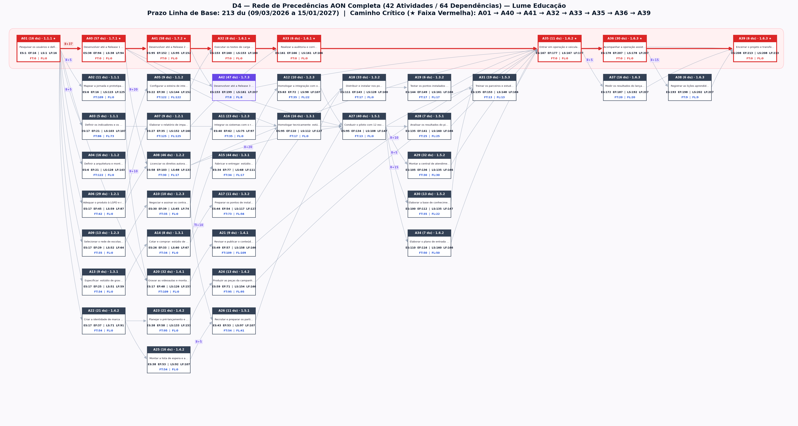

# D4 — Rede de Precedências AON e Caminho Crítico (Ticket 2.3 / M1 / R4)

**Projeto:** Lume Educação | **Responsável:** Nara Pereira Sousa | **Base:** `07_atividades` (42) + `08_dependencias` (64)

- **Prazo Total da Linha de Base:** **213 dias úteis** (`09/03/2026` a `15/01/2027`)
- **Caminho Crítico (8 atividades, `FT = 0` e `FL = 0`):** `A01 → A40 → A41 → A32 → A33 → A35 → A36 → A39`
- **Diagrama Editável (Excalidraw):** [`docs/d4-rede-precedencias.excalidraw`](./d4-rede-precedencias.excalidraw)
- **Diagrama em Imagem:** [`docs/d4-rede-precedencias.png`](./d4-rede-precedencias.png)
- **View SQL Reativa (Supabase):** [`sql/vw_rede_pert_cpm.sql`](../sql/vw_rede_pert_cpm.sql)

## Tabela Completa da Rede (42 Atividades)

| ID | EAP | Atividade | D (du) | ES | EF | LS | LF | FT | FL | Início Cedo | Término Cedo | Crítica? |
| :--- | :---: | :--- | :---: | :---: | :---: | :---: | :---: | :---: | :---: | :---: | :---: | :---: |
| **A01** | 1.1.1 | Pesquisar os usuários e definir o MVP | 16 | 1 | 16 | 1 | 16 | 0 | 0 | 09/03/2026 | 30/03/2026 | **SIM** |
| **A02** | 1.1.1 | Mapear a jornada e prototipar as telas-chave | 11 | 6 | 16 | 115 | 125 | 109 | 0 | 16/03/2026 | 30/03/2026 | Não |
| **A03** | 1.1.1 | Definir os indicadores e os OKRs do produto | 5 | 17 | 21 | 103 | 107 | 86 | 73 | 31/03/2026 | 07/04/2026 | Não |
| **A04** | 1.1.2 | Definir a arquitetura e montar os ambientes de nuvem | 16 | 6 | 21 | 128 | 143 | 122 | 0 | 16/03/2026 | 07/04/2026 | Não |
| **A05** | 1.1.2 | Configurar a esteira de integração e entrega contínuas | 9 | 22 | 30 | 144 | 152 | 122 | 122 | 08/04/2026 | 20/04/2026 | Não |
| **A06** | 1.2.1 | Adequar o produto à LGPD e redigir os termos de uso | 29 | 17 | 45 | 59 | 87 | 42 | 0 | 31/03/2026 | 13/05/2026 | Não |
| **A07** | 1.2.1 | Elaborar o relatório de impacto à proteção de dados | 9 | 27 | 35 | 152 | 160 | 125 | 125 | 15/04/2026 | 28/04/2026 | Não |
| **A08** | 1.2.2 | Licenciar os direitos autorais e adequar à LGPD para menores de idade | 46 | 58 | 103 | 88 | 133 | 30 | 17 | 01/06/2026 | 06/08/2026 | Não |
| **A09** | 1.2.3 | Selecionar o rede de escolas parceiras e os fornecedores-chave | 13 | 17 | 29 | 52 | 64 | 35 | 0 | 31/03/2026 | 17/04/2026 | Não |
| **A10** | 1.2.3 | Negociar e assinar os contratos de parceria | 10 | 30 | 39 | 65 | 74 | 35 | 0 | 20/04/2026 | 05/05/2026 | Não |
| **A11** | 1.2.3 | Integrar os sistemas com o rede de escolas parceiras | 23 | 40 | 62 | 75 | 97 | 35 | 0 | 06/05/2026 | 08/06/2026 | Não |
| **A12** | 1.2.3 | Homologar a integração com o rede de escolas parceiras | 10 | 63 | 72 | 98 | 107 | 35 | 22 | 09/06/2026 | 22/06/2026 | Não |
| **A13** | 1.3.1 | Especificar: estúdio de gravação e ilha de edição | 9 | 17 | 25 | 51 | 59 | 34 | 0 | 31/03/2026 | 13/04/2026 | Não |
| **A14** | 1.3.1 | Cotar e comprar: estúdio de gravação e ilha de edição | 8 | 26 | 33 | 60 | 67 | 34 | 0 | 14/04/2026 | 24/04/2026 | Não |
| **A15** | 1.3.1 | Fabricar e entregar: estúdio de gravação e ilha de edição | 44 | 34 | 77 | 68 | 111 | 34 | 17 | 27/04/2026 | 30/06/2026 | Não |
| **A16** | 1.3.1 | Homologar tecnicamente: estúdio de gravação e ilha de edição | 16 | 95 | 110 | 112 | 127 | 17 | 0 | 27/07/2026 | 17/08/2026 | Não |
| **A17** | 1.3.2 | Preparar os pontos de instalação | 11 | 44 | 54 | 117 | 127 | 73 | 56 | 12/05/2026 | 26/05/2026 | Não |
| **A18** | 1.3.2 | Distribuir e instalar nos pontos | 33 | 111 | 143 | 128 | 160 | 17 | 0 | 18/08/2026 | 02/10/2026 | Não |
| **A19** | 1.3.2 | Testar os pontos instalados por amostragem | 6 | 144 | 149 | 161 | 166 | 17 | 17 | 05/10/2026 | 13/10/2026 | Não |
| **A20** | 1.4.1 | Gravar as videoaulas e montar o banco de questões | 32 | 17 | 48 | 126 | 157 | 109 | 0 | 31/03/2026 | 18/05/2026 | Não |
| **A21** | 1.4.1 | Revisar e publicar o conteúdo | 9 | 49 | 57 | 158 | 166 | 109 | 109 | 19/05/2026 | 29/05/2026 | Não |
| **A22** | 1.4.2 | Criar a identidade de marca e os materiais | 21 | 17 | 37 | 71 | 91 | 54 | 0 | 31/03/2026 | 30/04/2026 | Não |
| **A23** | 1.4.2 | Planejar o pré-lançamento e a campanha | 21 | 38 | 58 | 133 | 153 | 95 | 0 | 04/05/2026 | 01/06/2026 | Não |
| **A24** | 1.4.2 | Produzir as peças da campanha | 13 | 59 | 71 | 154 | 166 | 95 | 95 | 02/06/2026 | 19/06/2026 | Não |
| **A25** | 1.4.2 | Montar a lista de espera e a comunidade de primeiros usuários | 16 | 38 | 53 | 92 | 107 | 54 | 0 | 04/05/2026 | 25/05/2026 | Não |
| **A26** | 1.5.1 | Recrutar e preparar os participantes do piloto | 11 | 43 | 53 | 97 | 107 | 54 | 41 | 11/05/2026 | 25/05/2026 | Não |
| **A27** | 1.5.1 | Conduzir o piloto com 12 escolas parceiras do interior | 40 | 95 | 134 | 108 | 147 | 13 | 0 | 27/07/2026 | 21/09/2026 | Não |
| **A28** | 1.5.1 | Analisar os resultados do piloto e definir os ajustes | 7 | 135 | 141 | 160 | 166 | 25 | 25 | 22/09/2026 | 30/09/2026 | Não |
| **A29** | 1.5.2 | Montar a central de atendimento e o suporte | 32 | 105 | 136 | 135 | 166 | 30 | 30 | 10/08/2026 | 23/09/2026 | Não |
| **A30** | 1.5.2 | Elaborar a base de conhecimento e os roteiros de atendimento | 13 | 100 | 112 | 135 | 147 | 35 | 22 | 03/08/2026 | 19/08/2026 | Não |
| **A31** | 1.5.3 | Treinar os parceiros e estudantes | 19 | 135 | 153 | 148 | 166 | 13 | 13 | 22/09/2026 | 19/10/2026 | Não |
| **A32** | 1.6.1 | Executar os testes de carga e de segurança | 8 | 153 | 160 | 153 | 160 | 0 | 0 | 19/10/2026 | 28/10/2026 | **SIM** |
| **A33** | 1.6.1 | Realizar a auditoria e corrigir os apontamentos | 6 | 161 | 166 | 161 | 166 | 0 | 0 | 29/10/2026 | 06/11/2026 | **SIM** |
| **A34** | 1.6.2 | Elaborar o plano de entrada em operação e de retorno | 7 | 110 | 116 | 160 | 166 | 50 | 50 | 17/08/2026 | 25/08/2026 | Não |
| **A35** | 1.6.2 | Entrar em operação e veicular a campanha de lançamento | 11 | 167 | 177 | 167 | 177 | 0 | 0 | 09/11/2026 | 24/11/2026 | **SIM** |
| **A36** | 1.6.3 | Acompanhar a operação assistida pós-lançamento | 30 | 178 | 207 | 178 | 207 | 0 | 0 | 25/11/2026 | 07/01/2027 | **SIM** |
| **A37** | 1.6.3 | Medir os resultados do lançamento e ajustar o funil | 16 | 172 | 187 | 192 | 207 | 20 | 20 | 16/11/2026 | 08/12/2026 | Não |
| **A38** | 1.6.3 | Registrar as lições aprendidas | 6 | 193 | 198 | 202 | 207 | 9 | 9 | 16/12/2026 | 23/12/2026 | Não |
| **A39** | 1.6.3 | Encerrar o projeto e transferir para a operação | 6 | 208 | 213 | 208 | 213 | 0 | 0 | 08/01/2027 | 15/01/2027 | **SIM** |
| **A40** | 1.7.1 | Desenvolver até a Release 1 (MVP) — sprints 1 a 6 | 57 | 38 | 94 | 38 | 94 | 0 | 0 | 04/05/2026 | 24/07/2026 | **SIM** |
| **A41** | 1.7.2 | Desenvolver até a Release 2 — sprints 7 a 12 | 58 | 95 | 152 | 95 | 152 | 0 | 0 | 27/07/2026 | 16/10/2026 | **SIM** |
| **A42** | 1.7.3 | Desenvolver até a Release 3 — sprints 13 a 17 | 47 | 153 | 199 | 161 | 207 | 8 | 8 | 19/10/2026 | 24/12/2026 | Não |
